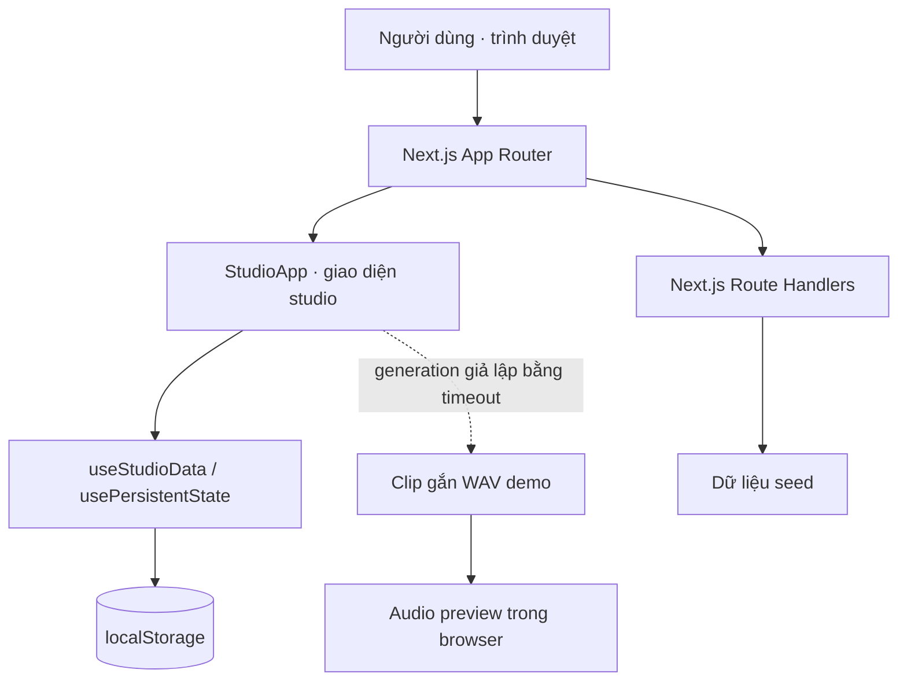
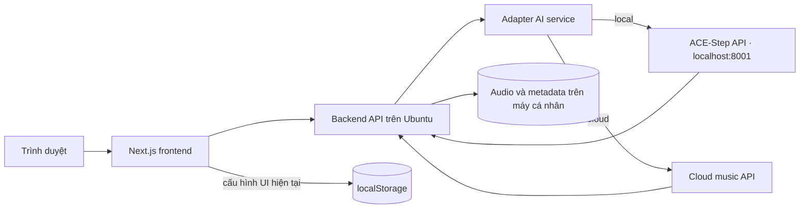

# Kiến trúc MugeStudio

## Phạm vi hiện tại

MugeStudio hiện là prototype frontend cho một ứng dụng dựng nhạc AI cá nhân. Frontend được xây bằng Next.js App Router, React và TypeScript. Một số Next.js Route Handler trả dữ liệu seed để minh họa API; chưa có backend lưu dữ liệu thật hoặc gọi nhà cung cấp AI. Các thay đổi của studio được lưu trong `localStorage` của trình duyệt. Prototype có ba file WAV demo được phát thật trong trình duyệt; generation mới vẫn là thao tác giả lập và dùng lại file WAV mẫu theo nhạc cụ.

## Kiến trúc đang có



### Frontend

- `FE/src/app/` chứa các trang App Router. Các trang chính render `StudioApp`; component này dựa vào pathname để chọn màn hình.
- `FE/src/lib/components/StudioApp.tsx` chứa layout dùng chung và các màn hình dashboard, workspace, editor, generation, storage, metadata và logs.
- `FE/src/lib/components/AIServiceManager.tsx` là màn hình cấu hình service AI, truy cập tại `/ai-services`.
- `FE/src/lib/hooks/use-studio-data.ts` giữ projects, tracks, clips, sounds, storage và logs trong browser storage.
- `FE/src/lib/hooks/use-persistent-state.ts` đọc/ghi JSON qua `localStorage`.
- `FE/fake-data/seed.ts` cung cấp dữ liệu demo ban đầu.
- `FE/src/lib/styles/` chứa CSS của studio và các màn hình.

### Route và API hiện có

- `/dashboard`, `/workspace`, `/workspace/[projectId]/metadata`, `/generation`, `/edit`, `/logs`, `/storage`, `/api-guide`, `/ai-services` là giao diện frontend.
- `/api/projects`, `/api/projects/[projectId]`, `/api/projects/[projectId]/logs` và `/api/storage` hiện trả dữ liệu seed. Đây chưa phải API lưu trữ hoặc API backend hoàn chỉnh.
- `/ai-services` lưu cấu hình endpoint, model, loại local/cloud, bật/tắt và service mặc định trong `localStorage`. Nút kiểm tra gọi trực tiếp `GET {baseUrl}/health` với ACE-Step/custom; Gemini chỉ hiện thông báo cần backend vì hiện chưa có server để kiểm tra an toàn.
- Màn hình tạo nhạc cho chọn một service đã bật. Danh sách clip nằm ở vùng trung tâm; khi chọn một clip, inspector bên cạnh hiển thị prompt và settings để chỉnh metadata, copy setting hoặc tạo clip mới theo setting đó. Danh sách có trạng thái queued/running/succeeded/failed và nút mở clip trong editor.
- Chỉ có một project mẫu `Midnight in Kyoto`, với ba track liên quan đến các nguồn nhạc mẫu, sáu clip trên timeline và ba clip generation có metadata. Các project demo cũ được dọn khỏi localStorage; project do người dùng tạo vẫn được giữ.
- Ba file WAV drum, piano và bass trong `FE/public/demo-audio/` có thể phát và tải xuống. Generation list cho phép preview sample, sửa metadata và copy setting; frontend đồng bộ cặp `.wav`/`.meta` vào Storage.
- Generation mới vẫn mô phỏng job phía frontend, gắn WAV demo theo nhạc cụ và có thể nghe trong danh sách clip hoặc editor. ID và filename không đổi; metadata trong `.meta` được cập nhật khi chỉnh setting. Audio không được tạo bởi AI service.
- Editor dùng chung danh sách clip của project với generation; các clip mẫu phát WAV tương ứng và waveform timeline lấy peak từ file WAV. Transport phát các WAV theo vị trí trên timeline; người dùng có thể bấm/kéo playhead đỏ để seek và kéo âm thanh từ thư viện vào track. Editor giữ vị trí kéo clip theo điểm người dùng nắm, snap vào lưới, chọn vị trí không đè clip khác, cho đổi tên track và thu ngắn clip bằng tay nắm mép phải hoặc điều khiển trim.
- Editor phát clip đang chọn trong transport; thao tác trim giới hạn thời gian preview theo độ dài clip. Thư viện và Storage cũng có nút preview riêng.
- Thư viện/storage có ba file WAV demo tự tạo (drum, piano, bass) để nghe thử và tải xuống.

## Kiến trúc đích đề xuất

Với ứng dụng một người dùng chạy trên Ubuntu cá nhân, giữ frontend và backend trên máy cá nhân. Backend đóng vai trò BFF/adapter: nhận yêu cầu của frontend, xác thực cấu hình service, chuyển đổi payload theo provider, theo dõi job bất đồng bộ, tải audio về storage của MugeStudio và trả trạng thái cho frontend.



### Ranh giới service AI

Mỗi service có `id`, `name`, `deployment` (`local` hoặc `cloud`), `provider`, `baseUrl`, `model`, `enabled`, `isDefault` và trạng thái kết nối gần nhất. Dữ liệu này hiện chỉ ở browser storage. Khi backend được thêm, cấu hình service cần chuyển sang backend; frontend chỉ giữ ID service đang chọn và trạng thái hiển thị.

Không lưu API key trong `localStorage` hoặc gửi key từ trình duyệt đến provider. Backend nên nhận cloud credentials từ biến môi trường hoặc kho bí mật trên máy cá nhân, đồng thời chỉ cho gọi các service đã được cấu hình. Nếu backend cho phép nhập URL tự do, cần chặn truy cập địa chỉ nội bộ không được phép để tránh SSRF.

### Tích hợp ACE-Step 1.5 trên Ubuntu

ACE-Step 1.5 có API REST bất đồng bộ. Tài liệu upstream hướng dẫn cài qua `uv`, khởi động API bằng `uv run acestep-api`, mặc định tại `http://localhost:8001`; kiểm tra trạng thái bằng `GET /health`. Luồng tạo audio gồm `POST /release_task`, định kỳ `POST /query_result` cho đến khi job thành công/thất bại, sau đó tải file qua URL `/v1/audio` trả về. Xem [repository ACE-Step 1.5](https://github.com/ace-step/ACE-Step-1.5), [hướng dẫn cài đặt](https://github.com/ace-step/ACE-Step-1.5/blob/main/docs/en/INSTALL.md) và [REST API](https://github.com/ace-step/ACE-Step-1.5/blob/main/docs/en/API.md).

Giá trị mặc định trong prototype là `http://127.0.0.1:8001` và model `acestep-v15-turbo`. Cần xác nhận phần cứng/GPU, driver và cấu hình model trên máy Ubuntu thực tế trước khi chọn model. Không nên gọi trực tiếp API ACE-Step từ giao diện trong kiến trúc hoàn chỉnh: backend nên làm proxy để tránh phụ thuộc CORS, quản lý timeout/job, và đưa audio vào storage của studio.

### Tích hợp Gemini Lyria

Trang Gemini được nêu trong yêu cầu giới thiệu sản phẩm Lyria, không phải endpoint API. Endpoint REST chính thức qua Gemini API là `POST https://generativelanguage.googleapis.com/v1beta/interactions`; request mẫu dùng model `lyria-3.5`, `Api-Revision: 2026-05-20`, và API key ở header `x-goog-api-key`. Model clip `lyria-3-clip-preview` tạo MP3 cố định 30 giây; `lyria-3.5` tạo track dài khoảng vài phút. Mặc định output là MP3; `lyria-3.5` có thể trả WAV qua `response_format`. Xem [Google AI music generation API](https://ai.google.dev/gemini-api/docs/music-generation) và [trang Gemini Lyria](https://gemini.google/overview/music-generation/).

Prototype thêm Gemini Lyria như một cấu hình cloud mẫu, tắt sẵn. Không gửi API key từ browser. Backend cần giữ key trong môi trường server và gọi Interactions API. Thời lượng giao diện tối đa 10 giây không khớp thời lượng clip Gemini 30 giây; adapter cần crop audio đầu ra hoặc báo rõ provider không hỗ trợ thời lượng đó.

### Luồng sinh nhạc khi backend sẵn sàng

1. Người dùng nhập prompt, tempo, độ dài và chọn service trong generation.
2. Frontend gửi `POST /api/generations` tới backend MugeStudio với `serviceId` và tham số đã chuẩn hóa.
3. Backend adapter gọi provider. Với ACE-Step, gửi `POST /release_task` và nhận `task_id`.
4. Frontend theo dõi `GET /api/generations/{id}`; backend truy vấn ACE-Step `/query_result`.
5. Backend tải kết quả, ghi metadata và file vào storage, rồi trả clip hoàn chỉnh cho editor.

Prompt/audio tham chiếu có thể chứa dữ liệu riêng tư; khi dùng cloud, giao diện nên cho biết service nào nhận dữ liệu đó.

## Tổ chức code hiện tại

```text
FE/
  src/app/                  Route Next.js và Route Handler demo
  src/lib/components/       StudioApp, màn hình và component giao diện
  src/lib/hooks/            State và persistence phía trình duyệt
  src/lib/api/              Client, endpoint và API catalog frontend
  src/lib/storage/          Tiện ích file demo phía trình duyệt
  src/lib/types/            Kiểu dữ liệu dùng chung trong frontend
  src/lib/styles/           CSS
  fake-data/                Seed cho prototype
BE/readme.md                Kế hoạch backend; hiện chưa có mã backend
```

## Những việc cần có trước khi dùng thật

- Tạo backend API và một adapter ACE-Step; bỏ giả lập `setTimeout` trong `generateClip`.
- Chuyển dữ liệu projects, jobs, logs và cấu hình service khỏi `localStorage` nếu cần dùng ngoài một trình duyệt.
- Thêm lưu trữ file audio trên đĩa và liên kết clip trong editor với file thật.
- Kiểm tra kết nối service qua backend thay vì gọi trực tiếp từ browser.
- Thêm trạng thái queued/running/succeeded/failed, retry/cancel, timeout và xử lý lỗi provider.
- Bổ sung kiểm tra tương thích các chế độ generation của UI với API provider. Các chế độ hum/reference hiện cũng là prototype.
