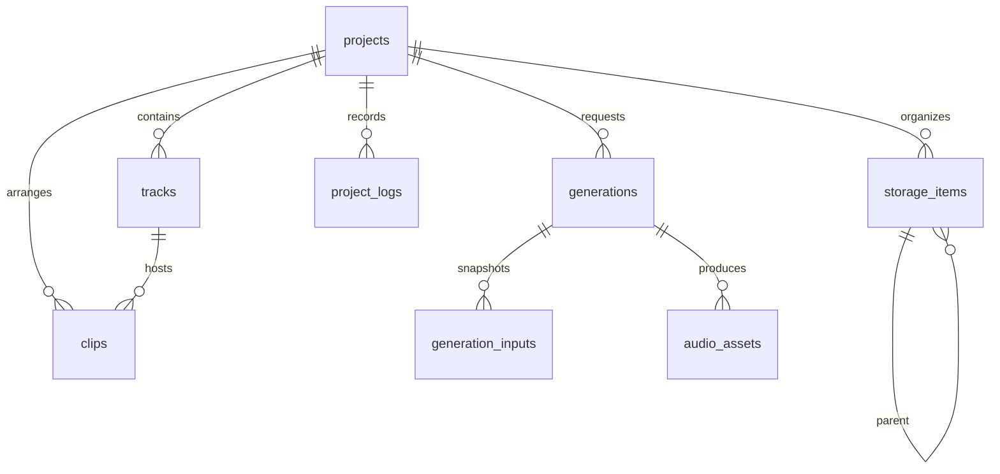

# MugeStudio Backend Schema Proposal (Dummy Generation MVP)

Created: November 26, 2026  
Scope: An MVP backend schema for connecting MugeStudio's AI music generation API to the frontend with dummy data

## 1. Purpose and assumptions

This proposal adapts the earlier `schemas_v2.md` to the current MugeStudio screens and repository rather than copying it unchanged. MugeStudio is a music production studio with projects, tracks, timeline clips, audio storage, and AI service settings. The first backend implementation will not call a real generation provider. It will simulate job processing and return existing WAV samples.

The current project documentation says that the backend is not implemented yet. The frontend has seed API handlers, `localStorage`, and simulated generation. The backend plan proposes SQLite and local file storage for a single-user local installation. This proposal follows that direction.

### Included in the MVP

- Read access to projects, tracks, and timeline clips
- An asynchronous generation job API that returns dummy audio
- Persistence of job inputs, status, and results
- Records for generated audio references and metadata
- Project activity logs
- Reproducible demos using deterministic seed data

### Deferred beyond the MVP

- Login, participants, share codes, and collaborative editing
- Real AI provider integrations and provider-specific parameters
- MIDI, stem separation, and full-project mixdown
- A general-purpose phrase library
- Authentication, billing, and multi-user support for public deployment

The original schema's participants, share codes, parts, phrase library, MIDI, and stem outputs are sensible for a collaborative composition app, but they are outside the initial backend task and do not match the current MugeStudio screens. Add them if they are confirmed as product requirements later.

## 2. Recommended implementation order

1. Agree on the API contract first: generation input, status, and result JSON examples with the frontend owner.
2. Add the database schema and seed data. Map the existing `midnight-in-kyoto` project and bundled sample WAV files.
3. Implement generation creation and status endpoints using a dummy service.
4. Connect the frontend generation flow to the API and status polling.
5. Add AI service management, real provider adapters, cancellation, and durable file storage as requirements call for them.

Recommended technology choices are a separate FastAPI backend alongside the existing `FE` app, SQLite for local single-user use, and filesystem storage for audio. Existing Next.js Route Handlers can remain as compatibility endpoints or proxy requests to the backend so the frontend can use the same origin. The team should decide which API is authoritative before implementation.

## 3. Entity relationship overview



`ai_services` is an optional table for the dummy service configuration. Never store secrets in the database or browser.

## 4. Proposed tables

### `projects`

| Column | Type | Constraints and notes |
| --- | --- | --- |
| `id` | TEXT | Primary key; use string IDs to match the existing frontend |
| `name` | TEXT | NOT NULL |
| `description` | TEXT | Nullable |
| `bpm` | REAL | Nullable; positive when present |
| `musical_key` | TEXT | Nullable |
| `status` | TEXT | `Draft`, `In progress`, or `Complete` |
| `created_at` | TEXT | ISO 8601 UTC |
| `updated_at` | TEXT | ISO 8601 UTC |

### `tracks`

| Column | Type | Constraints and notes |
| --- | --- | --- |
| `id` | TEXT | Primary key |
| `project_id` | TEXT | FK to `projects.id`, cascade on delete |
| `name` | TEXT | NOT NULL |
| `kind` | TEXT | `instrument` or `audio` |
| `color` | TEXT | UI display value; validate allowed colors in the application |
| `sort_order` | INTEGER | NOT NULL, default 0 |
| `volume` | REAL | 0–100, default 100 |
| `muted` | INTEGER | Boolean, default 0 |
| `solo` | INTEGER | Boolean, default 0 |

### `audio_assets`

Represents the stored audio file and its origin. A generation output and a Storage file can reference the same asset.

| Column | Type | Constraints and notes |
| --- | --- | --- |
| `id` | TEXT | Primary key |
| `project_id` | TEXT | FK to `projects.id`; nullable for shared demo samples |
| `name` | TEXT | Display name |
| `relative_path` | TEXT | NOT NULL; never expose an absolute filesystem path through the API |
| `mime_type` | TEXT | For example, `audio/wav` |
| `format` | TEXT | For example, `wav` |
| `size_bytes` | INTEGER | NOT NULL, zero or greater |
| `duration_ms` | INTEGER | Nullable |
| `source_kind` | TEXT | `demo`, `upload`, or `generation` |
| `created_at` | TEXT | ISO 8601 UTC |

Resolve relative paths under the configured data directory and verify that the normalized path remains inside it. MVP seed audio can reference the drum, piano, and bass WAV files in `FE/public/demo-audio/`. If the backend is deployed independently from FE, copy the seed audio into the backend data directory.

### `clips`

A clip is an arrangement placement, separate from its audio asset. Multiple clips can reference the same asset.

| Column | Type | Constraints and notes |
| --- | --- | --- |
| `id` | TEXT | Primary key |
| `project_id` | TEXT | FK to `projects.id`, cascade on delete |
| `track_id` | TEXT | FK to `tracks.id` |
| `asset_id` | TEXT | FK to `audio_assets.id` |
| `name` | TEXT | NOT NULL |
| `start_ms` | INTEGER | NOT NULL, zero or greater |
| `duration_ms` | INTEGER | NOT NULL, greater than zero |
| `volume` | REAL | Nullable, 0–100 |
| `fade_in_ms` | INTEGER | Default 0 |
| `fade_out_ms` | INTEGER | Default 0 |
| `created_at` | TEXT | ISO 8601 UTC |

The UI currently uses pixel-based `start` and `width` values. Do not store those display values directly. The API should use timeline time in milliseconds; the frontend can convert that to pixels for rendering.

### `generations`

| Column | Type | Constraints and notes |
| --- | --- | --- |
| `id` | TEXT | Primary key; UUID or equivalent |
| `project_id` | TEXT | FK to `projects.id`, cascade on delete |
| `service_id` | TEXT | AI service ID; `dummy-audio` in the MVP |
| `version_no` | INTEGER | NOT NULL; unique together with `project_id` |
| `status` | TEXT | `queued`, `running`, `succeeded`, or `failed` |
| `mode` | TEXT | `prompt`, `reference`, or `humming`; reject unsupported modes with 422 |
| `prompt` | TEXT | NOT NULL |
| `settings_json` | TEXT | JSON containing normalized generation settings |
| `input_snapshot_json` | TEXT | Snapshot of inputs used for this generation |
| `error_code` | TEXT | Nullable machine-readable code |
| `error_message` | TEXT | Nullable user-safe explanation |
| `result_asset_id` | TEXT | FK to `audio_assets.id`; NULL until success |
| `result_json` | TEXT | Nullable result metadata such as duration |
| `is_demo` | INTEGER | Boolean; 1 for dummy output |
| `created_at` | TEXT | ISO 8601 UTC |
| `started_at` | TEXT | Nullable |
| `finished_at` | TEXT | Nullable |

When allocating `version_no` in SQLite, start a transaction for the project and allocate the number inside it. Keep `UNIQUE(project_id, version_no)` as the final safeguard. Do not run an unprotected `MAX + 1` query outside a transaction.

### `generation_inputs` (optional, recommended)

Records existing clips or assets used in a generation so prior inputs can be inspected even after a project is edited.

| Column | Type | Constraints and notes |
| --- | --- | --- |
| `generation_id` | TEXT | FK to `generations.id`; part of composite primary key |
| `asset_id` | TEXT | FK to `audio_assets.id`; part of composite primary key |
| `clip_id` | TEXT | Nullable source clip |
| `track_name_snapshot` | TEXT | Track name at generation time |
| `asset_name_snapshot` | TEXT | Audio name at generation time |

If the MVP only accepts prompt input, this table can remain unused in the first release and be activated when reference or humming modes are implemented.

### `project_logs`

| Column | Type | Constraints and notes |
| --- | --- | --- |
| `id` | TEXT | Primary key |
| `project_id` | TEXT | FK to `projects.id`, cascade on delete |
| `action` | TEXT | For example, `Sound generated` |
| `detail` | TEXT | Description |
| `type` | TEXT | `create`, `edit`, `generate`, `import`, or `export` |
| `actor_name` | TEXT | Default to `Local user` in the MVP |
| `created_at` | TEXT | ISO 8601 UTC |

### `storage_items` (add when needed)

The current Storage UI displays a folder/file hierarchy. Add this table in the first release only if Storage integration is part of the generation API's acceptance criteria. Otherwise, start by listing `audio_assets`.

| Column | Type | Constraints and notes |
| --- | --- | --- |
| `id` | TEXT | Primary key |
| `project_id` | TEXT | FK to `projects.id`, nullable |
| `parent_id` | TEXT | Self-FK to `storage_items.id`; NULL means root |
| `asset_id` | TEXT | FK to `audio_assets.id` for files; NULL for folders |
| `name` | TEXT | NOT NULL |
| `item_type` | TEXT | `folder` or `file` |
| `created_at`, `updated_at` | TEXT | ISO 8601 UTC |

### `ai_services` (minimal in the dummy MVP)

| Column | Type | Constraints and notes |
| --- | --- | --- |
| `id` | TEXT | Primary key |
| `name` | TEXT | NOT NULL |
| `provider` | TEXT | `dummy`, `ace-step`, `gemini-lyria`, or `custom` |
| `deployment` | TEXT | `local` or `cloud` |
| `base_url` | TEXT | Nullable; do not accept arbitrary URLs from generation requests |
| `model` | TEXT | Nullable |
| `enabled` | INTEGER | Boolean |
| `is_default` | INTEGER | Boolean |
| `secret_ref` | TEXT | Nullable reference to a secret; never store the secret itself |

Seed only `dummy-audio` initially. Persistence of the AI service settings screen and its health-check API are separate scope.

## 5. MVP API contract

The proposed success envelope is `{ "data": ... }`, and the proposed error envelope is `{ "error": { "code": "...", "message": "..." } }`. The existing `FE/API_REFERENCE.md` uses `{ "error": "..." }`, so the team must choose one format. If the implementation retains the existing string format for frontend compatibility, document that consistently in the API guide.

### Start a generation

`POST /api/projects/{projectId}/generations`

```json
{
  "serviceId": "dummy-audio",
  "mode": "prompt",
  "input": {
    "prompt": "A warm piano motif over a slow lo-fi beat",
    "instrument": "Piano",
    "mood": "Dreamy",
    "bpm": 96,
    "key": "C major",
    "durationSeconds": 8,
    "effects": [],
    "negativePrompt": ""
  }
}
```

Response: `202 Accepted`

```json
{
  "data": {
    "generationId": "gen_01J...",
    "projectId": "midnight-in-kyoto",
    "versionNo": 4,
    "status": "queued",
    "isDemo": true,
    "pollUrl": "/api/generations/gen_01J..."
  }
}
```

### Get status and result

`GET /api/generations/{generationId}`

```json
{
  "data": {
    "generationId": "gen_01J...",
    "projectId": "midnight-in-kyoto",
    "versionNo": 4,
    "status": "succeeded",
    "isDemo": true,
    "createdAt": "2026-11-26T03:00:00Z",
    "finishedAt": "2026-11-26T03:00:03Z",
    "result": {
      "assetId": "asset_gen_01J...",
      "audioUrl": "/api/storage/files/asset_gen_01J.../content",
      "fileName": "gen_01J....wav",
      "durationSeconds": 8,
      "bpm": 96,
      "key": "C major"
    }
  }
}
```

On failure, return `status: "failed"` and `error: { "code", "message" }`. Return 404 when the requested generation ID does not exist.

### Fetch audio

`GET /api/storage/files/{assetId}/content` returns the audio bytes. Do not return a filesystem path. Resolve and validate the asset by ID before streaming the file.

### Read projects

Gradually replace the existing seed implementations of `GET /api/projects`, `GET /api/projects/{projectId}`, `GET /api/projects/{projectId}/logs`, and `GET /api/storage` with the same response shapes backed by the database. Use the existing frontend client and examples in `FE/API_REFERENCE.md` as the compatibility baseline.

## 6. Dummy generation behavior

- `dummy-audio` makes no external network calls.
- On success, return the existing drum, piano, or bass demo WAV that best matches the requested instrument.
- Set `isDemo: true` in both the API response and UI so sample audio is not mistaken for AI-generated audio.
- Use fixtures to control delay and result status for reproducible behavior. The normal demo should transition to `succeeded` after a short configurable delay. A development-only fixture should simulate `failed`.
- Validate supported modes and ranges for duration, BPM, and other inputs. Return `400` or `422` for invalid values.
- Demo results can reference a shared sample asset rather than copying the WAV for every generation. Copy the file only if a later requirement needs a distinct generated file.

## 7. Constraints and indexes

- Enable `PRAGMA foreign_keys = ON` for SQLite connections.
- Add appropriate foreign keys and delete rules. Deleting a project can cascade its dependent metadata, but must not physically delete shared sample audio that another project may reference.
- Indexes: `clips(project_id, track_id)`, unique `generations(project_id, version_no)`, `generations(status, created_at)`, `project_logs(project_id, created_at)`, and `storage_items(parent_id)`.
- Store audio on the filesystem, not in SQLite. Store its relative path, format, size, and duration in the database.
- Add user IDs, share codes, and provider-specific job IDs in migrations when those features are introduced.

## 8. Main changes from the earlier schema

| Earlier proposal | MugeStudio treatment | Reason |
| --- | --- | --- |
| `projects` | Keep, using string IDs and metadata compatible with the frontend | Existing UI/API uses string IDs |
| `participants` / `share_code` | Exclude from MVP | Current design targets local single-user use |
| `project_parts` | Integrate with `tracks` | Tracks are MugeStudio's timeline editing units |
| `phrases` / `project_phrases` | Exclude for MVP; record generation references in `generation_inputs` | Initial task is a dummy generation API; a shared phrase library is not implemented |
| `moods` / `project_moods` | Do not create separate master tables; snapshot mood in generation settings | The UI selects a mood per generation |
| `generations` | Keep and align status/settings with the UI | Asynchronous generation is the core feature |
| `generation_outputs` | Organize around `audio_assets` and generation result references | Clips, Storage, and generations should share audio asset records |
| MIDI / stems | Defer for future expansion | Current UI and demo audio are WAV-focused |
| PostgreSQL | Prefer SQLite initially | Matches the local single-user backend plan |

## 9. Decisions for the team before implementation

1. Should the backend be a separate FastAPI service or implemented in existing Next.js Route Handlers?
2. How do generation API fields map to the existing frontend, especially `serviceId`, mode, duration, instrument, and effects?
3. Does the first delivery include only the API, or also frontend integration and Storage display?
4. Is database persistence required in the first delivery? An in-memory demo is possible, but jobs will disappear after a server restart.
5. How should a dummy failure be triggered during development (test fixture, fixed prompt, or another mechanism)?
6. Where should `isDemo` be shown: generation list, clip view, and/or API documentation?

## 10. Related repository documents

- [Backend plan](../BE/readme.md)
- [Overall architecture](architecture.md)
- [Frontend API reference](../FE/API_REFERENCE.md)
- [Frontend shared types](../FE/src/lib/types/index.ts)
