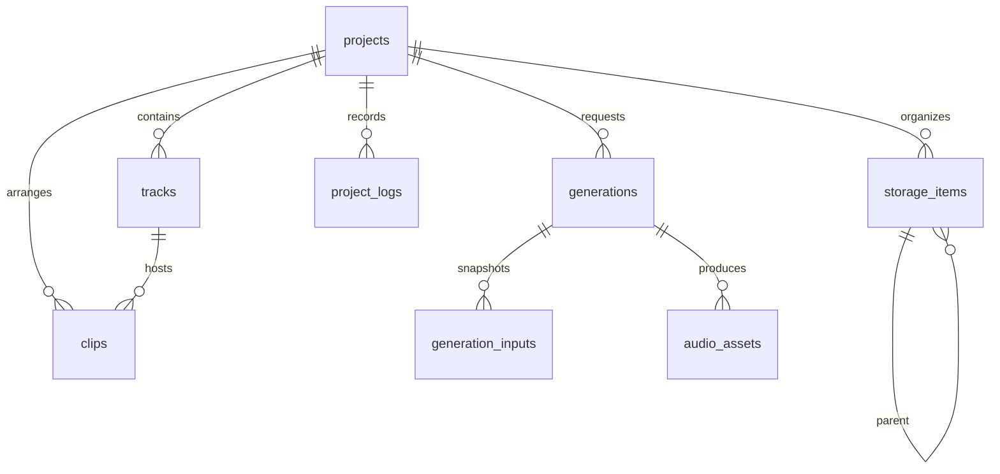

# MugeStudio バックエンドスキーマ案（ダミー生成 MVP）

作成日: 2026年11月26日  
対象: MugeStudio の AI 音楽生成 API を、ダミーデータでフロントエンドと接続する MVP

## 1. 目的と前提

本案は `schemas_v2.md` の要件をそのまま移植するのではなく、現在の MugeStudio の画面とリポジトリに合わせて再構成した案です。MugeStudio はプロジェクト、トラック、タイムライン上のクリップ、音源ストレージ、AIサービス設定を持つ音楽制作スタジオです。初回実装では実際の生成AIを呼ばず、既存の WAV サンプルを使ってジョブの受付・進行・成功・失敗を再現します。

現在の設計資料では、バックエンドは未実装で、フロントエンドに seed API、`localStorage`、生成シミュレーションがあります。バックエンド設計資料はローカル利用を想定し、SQLite とローカルファイル保存を提案しています。本案もこの前提に合わせます。

### MVPに含める

- プロジェクト、トラック、タイムライン上のクリップの読み取り
- ダミー音源を返す非同期 generation job API
- ジョブの入力条件・状態・結果の記録
- 生成音源の参照先とメタデータの記録
- プロジェクト操作ログ
- 決定的な seed データによる再現可能なデモ

### MVPでは後回し

- ログイン、参加者、共有コード、共同編集
- 実AIプロバイダー接続と外部API固有パラメータ
- MIDI、ステム分離、曲全体のミックスダウン
- 汎用フレーズライブラリ
- 認証・課金・外部公開向けのマルチユーザー対応

元スキーマの「参加者・共有コード・パート・フレーズライブラリ・MIDI/ステム出力」は別の共同作曲アプリ向け機能としては筋が通っていますが、現在の MugeStudio の画面と初回バックエンド作業には含めません。要件として再確認された段階で追加します。

## 2. 推奨する実装順

1. API 契約を先に確定する。生成入力、状態、結果の JSON 例をフロント担当と合意する。
2. DB スキーマと seed を用意する。初期プロジェクト `midnight-in-kyoto` と既存サンプル WAV を対応づける。
3. generation 作成・状態取得 API を実装し、まずダミーサービスで動かす。
4. フロントの生成操作を API 呼び出しと状態ポーリングにつなぐ。
5. AI service 管理、実プロバイダー adapter、キャンセル、永続ストレージを要件に応じて追加する。

技術選択の推奨は、既存の `FE` と分離した FastAPI バックエンド、ローカル単一ユーザー運用向け SQLite、音声ファイルは filesystem 保存です。Next.js Route Handler は既存 seed API との互換や同一オリジン proxy に利用できます。どちらの API を正とするか、実装開始前にチームで決めてください。

## 3. ER概要



`ai_services` は MVP ではダミーサービスの設定レコードだけを置く任意テーブルです。秘密情報はDB・ブラウザーのいずれにも保存しません。

## 4. テーブル案

### projects

| 列 | 型 | 制約・説明 |
| --- | --- | --- |
| id | TEXT | PK。既存フロントの文字列IDと合わせる |
| name | TEXT | NOT NULL |
| description | TEXT | NULL可 |
| bpm | REAL | NULL可。正数 |
| musical_key | TEXT | NULL可 |
| status | TEXT | `Draft` / `In progress` / `Complete` |
| created_at | TEXT | ISO 8601 UTC |
| updated_at | TEXT | ISO 8601 UTC |

### tracks

| 列 | 型 | 制約・説明 |
| --- | --- | --- |
| id | TEXT | PK |
| project_id | TEXT | FK projects.id、削除時 CASCADE |
| name | TEXT | NOT NULL |
| kind | TEXT | `instrument` / `audio` |
| color | TEXT | UI表示用。許可色をアプリで検証 |
| sort_order | INTEGER | NOT NULL DEFAULT 0 |
| volume | REAL | 0–100、DEFAULT 100 |
| muted | INTEGER | boolean、DEFAULT 0 |
| solo | INTEGER | boolean、DEFAULT 0 |

### audio_assets

音声ファイル実体と、その由来を表す共通レコードです。generation output と Storage のファイルは同じ asset を参照できます。

| 列 | 型 | 制約・説明 |
| --- | --- | --- |
| id | TEXT | PK |
| project_id | TEXT | FK projects.id、NULL可（共通サンプル用） |
| name | TEXT | 表示名 |
| relative_path | TEXT | NOT NULL。一時ファイルや絶対パスを API へ露出しない |
| mime_type | TEXT | 例 `audio/wav` |
| format | TEXT | 例 `wav` |
| size_bytes | INTEGER | NOT NULL、0以上 |
| duration_ms | INTEGER | NULL可 |
| source_kind | TEXT | `demo` / `upload` / `generation` |
| created_at | TEXT | ISO 8601 UTC |

相対パスは設定されたデータディレクトリを基準に解決し、正規化後もその配下にあることを検証します。MVPの seed 音源は `FE/public/demo-audio/` の drum、piano、bass WAV を参照します。運用時に FE と独立させる場合は seed 音源をバックエンドの data ディレクトリに配置してください。

### clips

クリップは arrangement 上の配置です。音源実体とは分け、同じ asset を複数の clip で使えます。

| 列 | 型 | 制約・説明 |
| --- | --- | --- |
| id | TEXT | PK |
| project_id | TEXT | FK projects.id、削除時 CASCADE |
| track_id | TEXT | FK tracks.id |
| asset_id | TEXT | FK audio_assets.id |
| name | TEXT | NOT NULL |
| start_ms | INTEGER | NOT NULL、0以上 |
| duration_ms | INTEGER | NOT NULL、0より大きい |
| volume | REAL | 0–100、NULL可 |
| fade_in_ms | INTEGER | DEFAULT 0 |
| fade_out_ms | INTEGER | DEFAULT 0 |
| created_at | TEXT | ISO 8601 UTC |

UI の `start` と `width` の単位・意味は現状ピクセルベースのため、そのままDBに保存しません。APIではタイムライン時間をミリ秒で受け渡し、フロント側で表示スケールに変換します。

### generations

| 列 | 型 | 制約・説明 |
| --- | --- | --- |
| id | TEXT | PK。UUID等 |
| project_id | TEXT | FK projects.id、削除時 CASCADE |
| service_id | TEXT | AIサービスID。MVPは `dummy-audio` |
| version_no | INTEGER | NOT NULL。project_id と組で UNIQUE |
| status | TEXT | `queued` / `running` / `succeeded` / `failed` |
| mode | TEXT | `prompt` / `reference` / `humming`。未対応modeは422 |
| prompt | TEXT | NOT NULL |
| settings_json | TEXT | 正規化済み生成条件の JSON |
| input_snapshot_json | TEXT | 生成時に使った入力のスナップショット |
| error_code | TEXT | NULL可。機械処理用 |
| error_message | TEXT | NULL可。ユーザー表示可能な説明 |
| result_asset_id | TEXT | FK audio_assets.id、成功前はNULL |
| result_json | TEXT | NULL可。duration等の結果メタデータ |
| is_demo | INTEGER | boolean。ダミー結果なら1 |
| created_at | TEXT | ISO 8601 UTC |
| started_at | TEXT | NULL可 |
| finished_at | TEXT | NULL可 |

SQLiteで `version_no` を発行するときは、対象 project のトランザクションを開始して採番し、`UNIQUE(project_id, version_no)` を最終防衛線にします。単純な `MAX + 1` をトランザクション外で実行しません。

### generation_inputs（任意だが推奨）

生成に使った既存 clip / asset を記録し、後から project を編集しても過去 generation の入力を追えるようにします。

| 列 | 型 | 制約・説明 |
| --- | --- | --- |
| generation_id | TEXT | FK generations.id、複合PKの一部 |
| asset_id | TEXT | FK audio_assets.id、複合PKの一部 |
| clip_id | TEXT | NULL可。入力元 clip |
| track_name_snapshot | TEXT | 生成時のトラック名 |
| asset_name_snapshot | TEXT | 生成時の音源名 |

MVPで prompt だけを受け付けるなら、この表は初回リリースで空のまま、reference/humming を始める時に使い始めても構いません。

### project_logs

| 列 | 型 | 制約・説明 |
| --- | --- | --- |
| id | TEXT | PK |
| project_id | TEXT | FK projects.id、削除時 CASCADE |
| action | TEXT | 例 `Sound generated` |
| detail | TEXT | 説明 |
| type | TEXT | `create` / `edit` / `generate` / `import` / `export` |
| actor_name | TEXT | MVPでは既定値 `Local user` |
| created_at | TEXT | ISO 8601 UTC |

### storage_items（必要になった段階で導入）

現行 Storage UI は folder/file の階層を表示します。初期 generation API の完了条件に Storage 連携が含まれる場合のみ導入し、含まれない場合は `audio_assets` の一覧を先に提供します。

| 列 | 型 | 制約・説明 |
| --- | --- | --- |
| id | TEXT | PK |
| project_id | TEXT | FK projects.id、NULL可 |
| parent_id | TEXT | 自己FK storage_items.id、NULLはroot |
| asset_id | TEXT | fileの場合はFK audio_assets.id、folderならNULL |
| name | TEXT | NOT NULL |
| item_type | TEXT | `folder` / `file` |
| created_at / updated_at | TEXT | ISO 8601 UTC |

### ai_services（ダミーMVPでは最小）

| 列 | 型 | 制約・説明 |
| --- | --- | --- |
| id | TEXT | PK |
| name | TEXT | NOT NULL |
| provider | TEXT | `dummy` / `ace-step` / `gemini-lyria` / `custom` |
| deployment | TEXT | `local` / `cloud` |
| base_url | TEXT | NULL可。ユーザーリクエストから任意URLを受け取らない |
| model | TEXT | NULL可 |
| enabled | INTEGER | boolean |
| is_default | INTEGER | boolean |
| secret_ref | TEXT | NULL可。secretそのものは禁止 |

初回は `dummy-audio` だけを seed し、UIにあるAIサービス設定の保存・health check APIは別スコープとして扱います。

## 5. API契約（MVP）

全JSON成功応答は `{ "data": ... }`、エラーは `{ "error": { "code": "...", "message": "..." } }` に統一する案です。既存 `FE/API_REFERENCE.md` はエラー形式が `{ "error": "..." }` なので、どちらかへ揃える必要があります。実装では既存フロントに合わせて文字列形式を維持する場合も、APIガイドに明記してください。

### 生成開始

`POST /api/projects/{projectId}/generations`

```json
{
  "serviceId": "dummy-audio",
  "mode": "prompt",
  "input": {
    "prompt": "A warm piano motif over a slow lo-fi beat",
    "instrument": "Piano",
    "mood": "Dreamy",
    "bpm": 96,
    "key": "C major",
    "durationSeconds": 8,
    "effects": [],
    "negativePrompt": ""
  }
}
```

レスポンス: `202 Accepted`

```json
{
  "data": {
    "generationId": "gen_01J...",
    "projectId": "midnight-in-kyoto",
    "versionNo": 4,
    "status": "queued",
    "isDemo": true,
    "pollUrl": "/api/generations/gen_01J..."
  }
}
```

### 状態・結果取得

`GET /api/generations/{generationId}`

```json
{
  "data": {
    "generationId": "gen_01J...",
    "projectId": "midnight-in-kyoto",
    "versionNo": 4,
    "status": "succeeded",
    "isDemo": true,
    "createdAt": "2026-11-26T03:00:00Z",
    "finishedAt": "2026-11-26T03:00:03Z",
    "result": {
      "assetId": "asset_gen_01J...",
      "audioUrl": "/api/storage/files/asset_gen_01J.../content",
      "fileName": "gen_01J....wav",
      "durationSeconds": 8,
      "bpm": 96,
      "key": "C major"
    }
  }
}
```

失敗時は `status: "failed"` と `error: { "code", "message" }` を返します。`GET` はまだ存在しないIDに404を返します。

### 音声取得

`GET /api/storage/files/{assetId}/content` は音声バイト列を返します。ファイルパスをそのままレスポンスに含めず、asset IDで認可・検証してからストリームします。

### プロジェクト読み取り

既存の `GET /api/projects`、`GET /api/projects/{projectId}`、`GET /api/projects/{projectId}/logs` と `GET /api/storage` は seed API から同じ形式のDB-backed APIへ段階的に置き換えます。既存のUIクライアントと `FE/API_REFERENCE.md` の例を契約基準にします。

## 6. ダミー生成ルール

- `dummy-audio` は外部ネットワークへ接続しません。
- 成功時は既存の drum / piano / bass demo WAV のうち、instrument に合う音源を返します。
- 応答と画面の両方で `isDemo: true` を明示し、AI生成音源と混同させません。
- 再現性のためテスト用fixtureで待ち時間と結果状態を制御します。通常デモは短い設定可能な遅延後に `succeeded`、失敗デモは開発専用fixtureで `failed` を返します。
- 受け付ける `mode`、duration、bpmなどの範囲を検証し、不正値は `400` / `422` にします。
- demo音源はサンプルを指すだけなので、利用者ごとの生成ファイルとして複製保存する必要はありません。必要なら generation result が既存 asset を参照します。

## 7. 制約・インデックス

- SQLite接続時に `PRAGMA foreign_keys = ON` を設定します。
- テーブルには適切な外部キーと削除規則を付けます。project削除時は従属メタデータをCASCADEし、共有サンプル音源など他projectでも参照するファイルは物理削除しません。
- インデックス: `clips(project_id, track_id)`、`generations(project_id, version_no)` UNIQUE、`generations(status, created_at)`、`project_logs(project_id, created_at)`、`storage_items(parent_id)`。
- audio fileはSQLiteへ格納せず、相対パス、形式、サイズ、長さを保存します。
- MVPに不要なユーザーID、共有コード、プロバイダー固有のjob IDは、実際の機能を導入する時にmigrationで追加します。

## 8. 元スキーマからの主な変更

| 元案 | MugeStudio向けの扱い | 理由 |
| --- | --- | --- |
| projects | 維持しつつ既存フロントの文字列ID・metadataに合わせる | 既存UI/APIが文字列IDを利用 |
| participants / share_code | MVPから除外 | 現設計はローカル単一ユーザー |
| project_parts | tracksへ統合 | MugeStudioはtracksがtimeline上の編集単位 |
| phrases / project_phrases | MVPから除外。generation_inputsで生成条件の参照を記録 | 初回の仕事は生成APIのダミー化で、共通フレーズライブラリは未実装 |
| moods / project_moods | 独立マスタから除外し、generation settingsのsnapshotへ | 画面は生成ごとのmood選択を持つ |
| generations | 維持し、UIのstatus/settingsに合わせる | 非同期generationは中核機能 |
| generation_outputs | audio_assetsとgeneration結果参照へ整理 | clip、storage、generationの音声実体を共通参照する |
| MIDI / stems | 将来拡張へ | 現状UI/API・demo音源はWAV中心 |
| PostgreSQL | 初期はSQLiteを推奨 | ローカル単一ユーザー向け既存バックエンド計画と一致 |

## 9. 実装前にチームで決めること

1. バックエンドをFastAPIとして独立させるか、Next.js Route Handlerに実装するか。
2. generation APIと既存フロント項目の対応。特に `serviceId`、mode、duration、instrument、effects。
3. 初回完了の範囲がAPIのみか、フロント接続とStorage表示までか。
4. DB永続化を初回から行うか。デモ限定ならメモリ実装でもよいが、再起動後のjob消失を受け入れる必要がある。
5. dummy failureをどう開発時に再現するか（test fixture、固定prompt等）。
6. `isDemo` の表示を生成一覧・クリップ・APIドキュメントのどこまで出すか。

## 10. リポジトリ内の関連資料

- [Backend計画](../BE/readme.md)
- [全体アーキテクチャ](architecture.md)
- [Frontend APIリファレンス](../FE/API_REFERENCE.md)
- [Frontend共通型](../FE/src/lib/types/index.ts)
