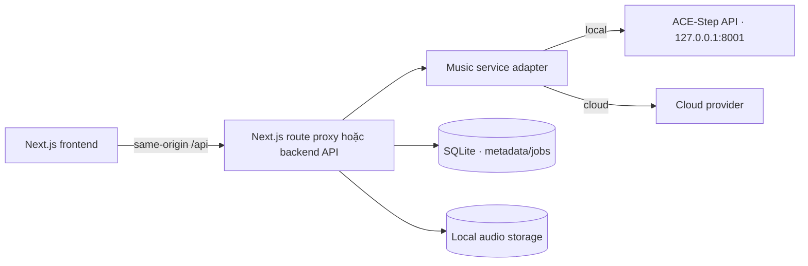

# MugeStudio Backend

## Trạng thái

> **Backend chưa được triển khai.** Thư mục này hiện chỉ có tài liệu thiết kế. Frontend Next.js đang dùng dữ liệu seed, `localStorage` và giả lập generation; các Route Handler hiện có trả dữ liệu demo, không kết nối database hoặc AI service.

## Mục tiêu

Backend phục vụ một người dùng chạy MugeStudio trên máy cá nhân, trước tiên trên Ubuntu. Backend chịu trách nhiệm:

- Làm cổng API ổn định giữa Next.js và các AI service local/cloud.
- Quản lý job sinh nhạc bất đồng bộ và chuẩn hóa trạng thái từ provider.
- Tải file kết quả về storage cục bộ, lưu metadata và trả URL/ID cho editor.
- Giữ credential của cloud provider ở phía server.
- Thay các API seed hiện tại bằng persistence thật cho project, job, log và storage.

## Kiến trúc đề xuất



Để khởi đầu trên một máy Ubuntu, dùng backend Python/FastAPI làm lớp adapter và orchestration là lựa chọn phù hợp vì ACE-Step cũng cung cấp REST API Python. Frontend nên gọi cùng origin Next.js; Next.js Route Handler có thể proxy sang backend để tránh CORS. Chỉ thêm database ngoài SQLite hoặc queue riêng khi có nhu cầu thực tế.

Không để browser gọi thẳng endpoint cloud hoặc chứa cloud API key. API backend chỉ nhận `serviceId` đã cấu hình, không nên nhận URL tùy ý từ mỗi request. Nếu cho phép cấu hình URL, backend phải chặn SSRF và chỉ cho gọi địa chỉ/service đã duyệt.

## ACE-Step 1.5 trên Ubuntu

Repository upstream yêu cầu Python 3.11–3.12 và khuyến nghị CUDA GPU (cũng có các backend phần cứng khác). Hướng dẫn nhanh upstream:

```bash
curl -LsSf https://astral.sh/uv/install.sh | sh
git clone https://github.com/ACE-Step/ACE-Step-1.5.git
cd ACE-Step-1.5
uv sync
uv run acestep-api
```

API mặc định chạy ở `http://localhost:8001`; kiểm tra bằng `GET /health`. Xem thêm [hướng dẫn cài đặt chính thức](https://github.com/ace-step/ACE-Step-1.5/blob/main/docs/en/INSTALL.md) để chọn backend theo GPU/driver, và [REST API chính thức](https://github.com/ace-step/ACE-Step-1.5/blob/main/docs/en/API.md) để biết payload, xác thực và cấu hình.

Luồng ACE-Step API:

1. `POST /release_task` với prompt và tham số generation; nhận `task_id`.
2. `POST /query_result` với `task_id_list` để lấy trạng thái. `0` là đang chạy, `1` thành công, `2` thất bại.
3. Khi thành công, phân tích result và tải audio từ URL `/v1/audio?path=...`.

## Gemini Lyria cloud adapter

Trang Gemini Music Generation là trang giới thiệu sản phẩm. Endpoint API để backend gọi là:

```text
POST https://generativelanguage.googleapis.com/v1beta/interactions
```

Request mẫu theo Gemini API:

```json
{
  "model": "lyria-3.5",
  "input": "A warm piano melody with a restrained lo-fi drum groove",
  "response_format": { "type": "audio" }
}
```

Gửi `x-goog-api-key`, `Api-Revision: 2026-05-20` và `Content-Type: application/json` từ backend. API key cần nằm trong môi trường server hoặc secret store, không nằm trong request từ browser. Response Interactions có audio base64 trong các output steps; adapter phải giải mã rồi ghi file WAV (đã yêu cầu `response_format`) cùng `.meta` vào storage. Tham khảo [tài liệu Gemini music generation](https://ai.google.dev/gemini-api/docs/music-generation) và [trang giới thiệu Lyria](https://gemini.google/overview/music-generation/).

`lyria-3-clip-preview` tạo clip MP3 dài cố định 30 giây. `lyria-3.5` tạo bài nhạc dài khoảng vài phút và hỗ trợ WAV; độ dài có thể được định hướng trong prompt. Form studio giới hạn tối đa 10 giây, nên adapter cần crop output hoặc thông báo rõ thời lượng thực tế trước khi lưu. Xem [tài liệu model và định dạng đầu ra](https://ai.google.dev/gemini-api/docs/music-generation).

ACE-Step API mặc định bind vào loopback theo tài liệu upstream. Nên giữ nó trên cùng máy với backend. Nếu cần gọi từ thiết bị khác trong mạng LAN, cần chủ động cấu hình bind host, xác thực và firewall; không public port generation trực tiếp ra Internet.

## API MugeStudio dự kiến

| Method | Endpoint | Mục đích |
| --- | --- | --- |
| `GET` | `/api/ai-services` | Liệt kê cấu hình service đã đăng ký, không trả secret |
| `POST` | `/api/ai-services` | Thêm service local/cloud |
| `PATCH` | `/api/ai-services/{serviceId}` | Sửa, bật/tắt hoặc đặt mặc định |
| `DELETE` | `/api/ai-services/{serviceId}` | Xóa service |
| `POST` | `/api/ai-services/{serviceId}/health` | Kiểm tra kết nối service từ backend |
| `POST` | `/api/generations` | Tạo generation job |
| `GET` | `/api/generations/{generationId}` | Lấy trạng thái/kết quả job |
| `POST` | `/api/generations/{generationId}/cancel` | Hủy job nếu provider hỗ trợ |
| `GET` | `/api/projects` | Liệt kê project |
| `GET`, `PATCH`, `DELETE` | `/api/projects/{projectId}` | Đọc, cập nhật, xóa project |
| `GET` | `/api/projects/{projectId}/logs` | Đọc lịch sử project |
| `GET` | `/api/storage` | Liệt kê file/folder |

Payload generation gợi ý:

```json
{
  "projectId": "midnight-in-kyoto",
  "serviceId": "ace-step-local",
  "input": {
    "prompt": "A warm piano motif over a slow lo-fi beat",
    "durationSeconds": 10,
    "bpm": 96,
    "model": "acestep-v15-turbo",
    "audioFormat": "wav"
  }
}
```

Phản hồi `POST /api/generations` nên trả `202 Accepted` cùng `generationId` và trạng thái `queued`. Backend chuẩn hóa trạng thái về `queued | running | succeeded | failed | canceled`, không để frontend phụ thuộc enum của một provider. Khi hoàn tất, trả ID/URL file nội bộ và metadata như duration, BPM, key, model, prompt và service đã dùng.

## Dữ liệu và lưu trữ đề xuất

- **AIService**: ID, tên, kiểu `local/cloud`, provider (`ace-step`, `gemini-lyria`, `custom`), base URL, model, enabled, default và lần health check gần nhất. Secret lưu trong env/OS credential store; chỉ lưu secret reference trong metadata.
- **Generation**: ID, project ID, service ID, trạng thái, prompt/tham số, provider task ID, lỗi đã chuẩn hóa, timestamps và output file ID.
- **Project/Track/Clip/Log**: metadata của project dựng nhạc. Clip tham chiếu file audio và thông tin vị trí trên timeline.
- **Storage**: mỗi clip hoàn tất có cặp `{clipId}.wav` và `{clipId}.meta`; file audio trên filesystem cục bộ, metadata sidecar giữ prompt/settings/service/status. SQLite giữ metadata, ID/filename bất biến, đường dẫn tương đối, dung lượng, định dạng và parent folder.

Không lưu audio nhị phân trong SQLite. Lưu đường dẫn tương đối dưới thư mục dữ liệu cấu hình, ví dụ `data/audio/{projectId}/{generationId}.wav`; xác thực đường dẫn để không cho truy cập ra ngoài thư mục storage.

## Cấu hình môi trường gợi ý

```dotenv
MUGE_DATA_DIR=./data
MUGE_DATABASE_URL=sqlite:///./data/mugestudio.db
ACESTEP_BASE_URL=http://127.0.0.1:8001
# Cloud keys chỉ đặt ở backend, ví dụ:
# MUSIC_PROVIDER_API_KEY=...
```

> Không commit `.env` hoặc API key vào Git. Giao diện `/ai-services` hiện chỉ lưu metadata trong browser và chưa gửi credential nào.

## Việc cần làm tiếp theo

1. Chọn và scaffold backend FastAPI, cấu hình CORS/proxy chỉ cho môi trường local.
2. Làm ACE-Step adapter: health check, submit task, poll result, download audio, timeout và lỗi.
3. Thêm SQLite và filesystem storage; expose route tương thích với frontend.
4. Thay generation placeholder bằng job thật, cập nhật UI polling và lưu clip/audio.
5. Thêm adapter cloud cụ thể sau khi chọn provider; credential chỉ được backend đọc.
6. Xác minh quy trình cài đặt với Ubuntu, GPU/driver và cấu hình ACE-Step thực tế của máy.

## Tài liệu liên quan

- [Kiến trúc frontend và tổng thể](../.docs/architecture.md)
- [Frontend README](../FE/readme.md)
- [ACE-Step 1.5 upstream](https://github.com/ace-step/ACE-Step-1.5)
